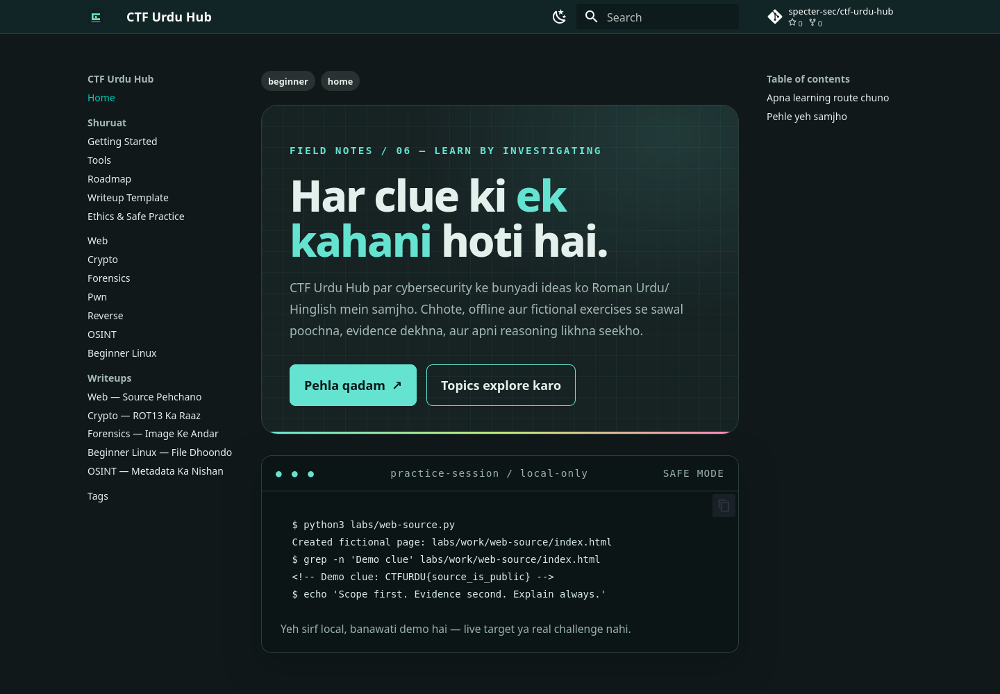
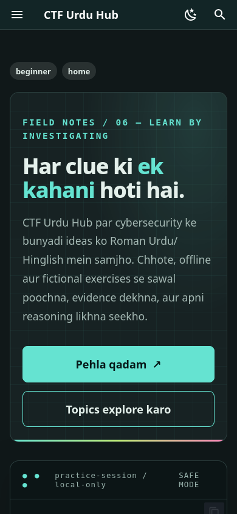
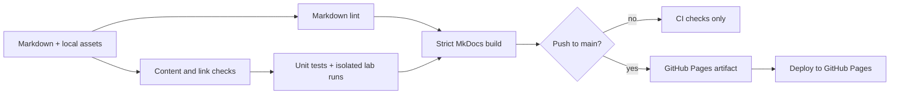

# CTF Urdu Hub

**By IFTIKHAR** · Roman Urdu/Hinglish cybersecurity learning notes · [Live site](https://specter-sec.github.io/ctf-urdu-hub/)

CTF Urdu Hub is a static, beginner-friendly documentation project for learning CTF concepts through short explanations and deterministic offline practice fixtures. It is designed to make safe scope, clear reasoning, and reproducible notes part of the learning process.

## What is here

- A polished MkDocs Material site with dark/light mode, English search suggestions and highlights, tags, code-copy buttons, section navigation, a table of contents, and previous/next page navigation.
- Seven topic routes: Web, Crypto, Forensics, Pwn, Reverse, OSINT, and Beginner Linux.
- Roman Urdu/Hinglish setup guides, an ethical-practice guide, and a reusable writeup template.
- Five offline, fictional practice generators under `labs/`. They create local sample material only and do not need a network connection.
- GitHub Actions for linting, tests, strict documentation builds, and an isolated GitHub Pages deployment from `main`.

## Screenshots

Actual desktop and phone-width captures of the rendered site, using only fictional local practice content:

| Desktop | Mobile |
| --- | --- |
|  |  |

## Get started

Requirements: Python 3.11 or newer. Node.js 22 or newer is needed for Markdown linting. Published pages use local theme assets, with no remote fonts, analytics, or additional setup plugin.

The pinned MkDocs Material release is the latest stable version checked on 2026-11-16. Its upstream maintainers have announced end of life for May 5, 2027, with critical maintenance through that date ([official maintenance notice](https://squidfunk.github.io/mkdocs-material/)); maintainers should reassess the documentation engine before the support window closes.

### Kali Linux / Debian-family distributions

Use a virtual environment to keep project packages separate from the operating system's Python. On a fresh system, install Python and venv support if needed:

```sh
sudo apt update
sudo apt install python3 python3-venv git
git clone https://github.com/specter-sec/ctf-urdu-hub.git
cd ctf-urdu-hub
python3 -m venv .venv
. .venv/bin/activate
python -m pip install --upgrade pip
python -m pip install -r requirements.txt
```

For Node.js 22+, install the version supplied by your trusted system package source or Node.js distribution, then run:

```sh
npm ci
npm run lint
python -m unittest discover -s tests -v
python scripts/check_content.py
mkdocs serve
```

Open the local URL printed by MkDocs (usually `http://127.0.0.1:8000`). To produce the same strict site artifact CI builds, run `mkdocs build --strict`.

### Termux fallback (Android)

Termux package availability changes by repository. Install Python, Git, and a Node.js 22+ package if one is available in your configured Termux source:

```sh
pkg update
pkg install python git nodejs-lts clang make libyaml
git clone https://github.com/specter-sec/ctf-urdu-hub.git
cd ctf-urdu-hub
python -m venv .venv
. .venv/bin/activate
python -m pip install -r requirements.txt
npm ci
npm run lint
python -m unittest discover -s tests -v
python scripts/check_content.py
mkdocs serve --dev-addr 127.0.0.1:8000
```

If `nodejs-lts` is unavailable or below 22, Python can still serve/build the documentation; skip the Node lint command or install a supported Node.js release from a trusted source. The pinned requirements are the supported source of Python dependencies.

## Project layout

```text
.
├── docs/                 # MkDocs pages, CSS, logo, and categories
│   ├── categories/       # Seven topic introductions
│   ├── guides/           # Getting started, tools, roadmap
│   └── writeups/         # Five original offline practice writeups
├── labs/                 # Standard-library-only fictional fixture generators
├── scripts/check_content.py
├── tests/                # Validator and generator safety tests
├── .github/workflows/    # CI and Pages deployment
├── mkdocs.yml
└── requirements.txt
```

### Build and test flow



## Scope and threat model

This is an educational static site. It is **not** a scanner, exploit framework, challenge answer mirror, or service for collecting user data. Its five generators use Python's standard library to create deterministic fictional files in `labs/work/`. They do not contact the network, execute a target, or inspect files outside their fixed practice paths. Tests copy generators into a temporary project root before executing them and verify that output stays inside that root.

Readers should assume that third-party links and external training platforms are outside this repository's control. Use only explicitly authorized, purpose-built practice environments, avoid personal or confidential data, and follow local laws and platform rules. See [Ethics & Safe Practice](docs/ethics.md) and [Security policy](SECURITY.md).

## Content provenance

The five writeups are **original offline technique recreations** based on free, official topic references cited on their category pages. They are not copied task answers, are not reproductions of a live challenge, and do not contain live challenge flags. Demonstration markers are invented `CTFURDU{...}` strings generated for this local project. Third-party names and marks belong to their respective owners; this project is independent and is not affiliated with any CTF platform, vendor, or training provider.

## Verification status

The commands above are the reproducible checks for your checkout; a command listing is not a claim that your revision passed. Check its CI result for revision-specific verification. See [GitHub Actions](https://github.com/specter-sec/ctf-urdu-hub/actions) for build and deployment results. Deployment requires GitHub Pages to be enabled for the repository with the GitHub Actions source. The offline labs were exercised on Linux; Android device-specific package builds are not certified by this project.

## Contributing and licenses

Please read [CONTRIBUTING.md](CONTRIBUTING.md), the [Code of Conduct](CODE_OF_CONDUCT.md), and the [Security policy](SECURITY.md) before opening an issue or pull request. Project code is MIT-licensed; documentation and original learning content are licensed CC BY 4.0. See [`LICENSE`](LICENSE) and [`LICENSE-CONTENT`](LICENSE-CONTENT) for the exact mapping and notices.
